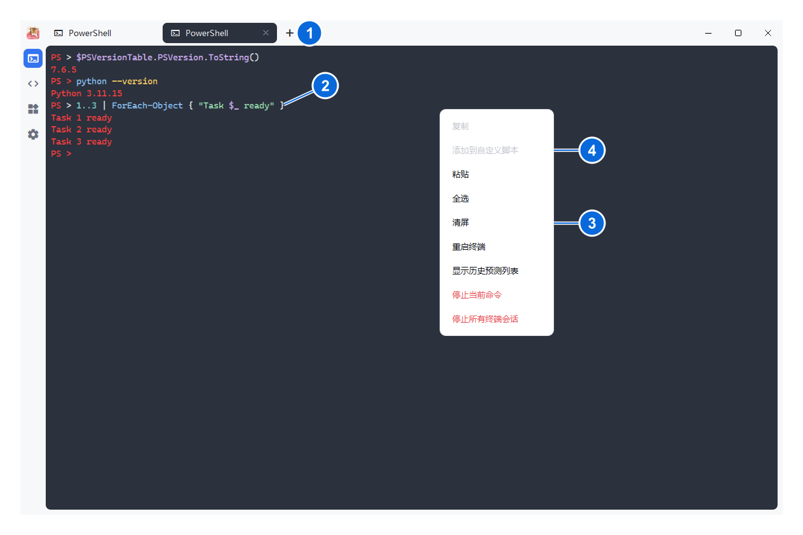
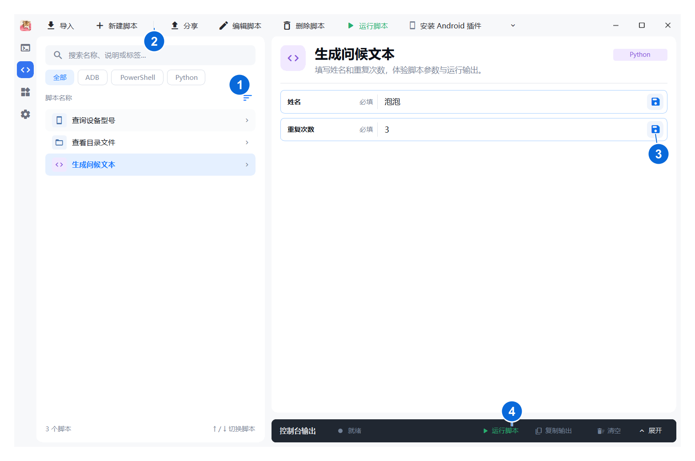
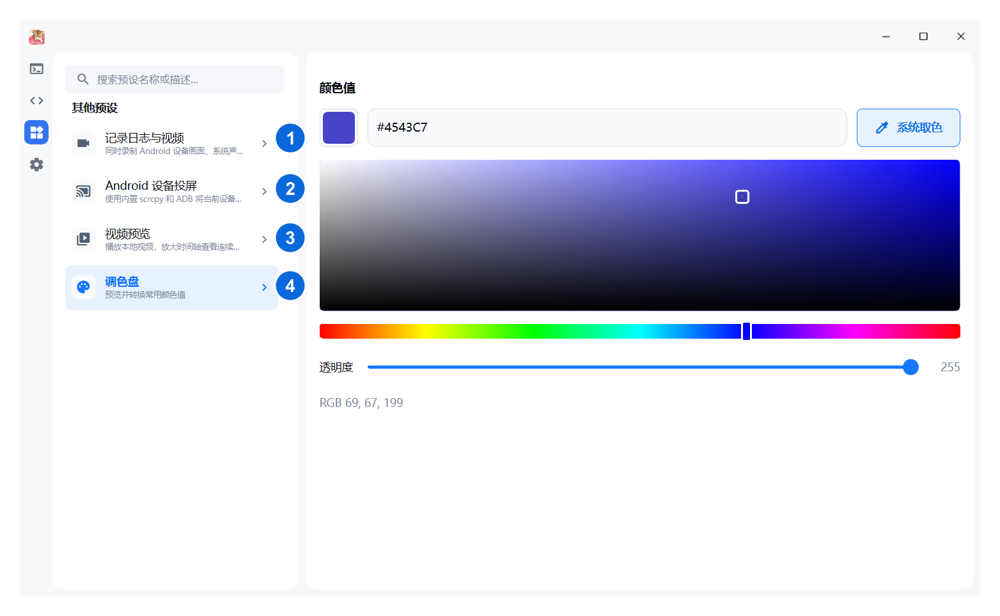
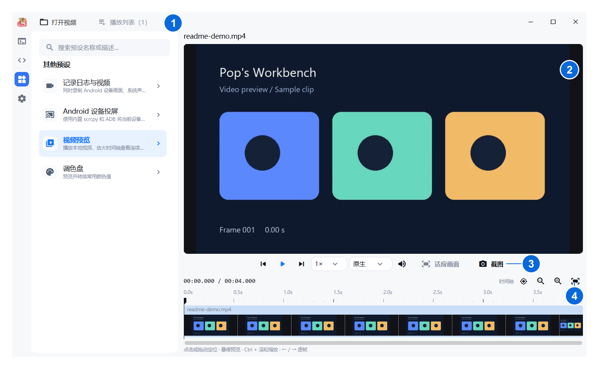
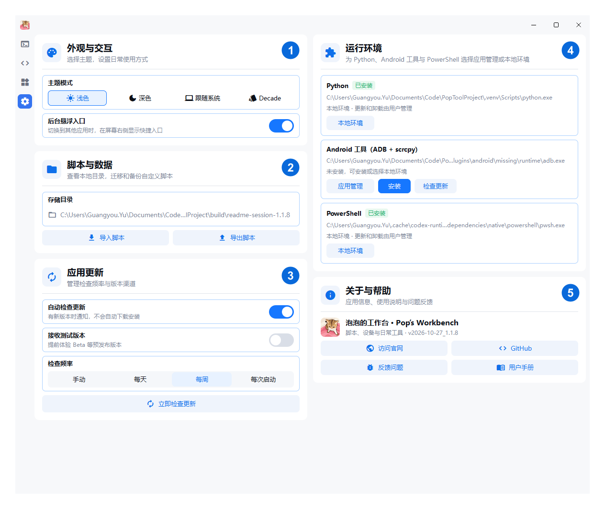
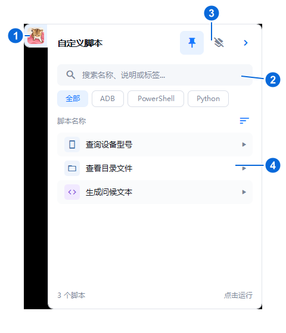

# 泡泡的工作台 · Pop’s Workbench

**当前版本：1.1.8** · Windows / macOS

[下载安装包](https://github.com/popkter/PopToolProject/releases) · [脚本使用指南](docs/Script-Guide.md) · [反馈问题](https://github.com/popkter/PopToolProject/issues)

## 应用定位

泡泡的工作台是一款面向开发、测试和日常脚本使用场景的本地桌面工作台，把命令调试、脚本复用、设备操作和常用辅助工具放在同一个应用中。

你可以先在终端里尝试命令，把重复操作保存为脚本，之后填写参数即可再次运行；需要投屏、录制、检查视频或取色时，则直接使用预设工具。切换到其他应用后，还能通过悬浮窗调用已保存的脚本。

**典型用法：终端验证命令 → 保存为自定义脚本 → 填写参数运行 → 从悬浮窗快捷调用。**

## 功能与页面

应用主要分为四个页面：

| 页面 | 主要解决的问题 |
| --- | --- |
| [终端](#终端) | 临时执行命令、调试脚本，保留多个独立 Shell 会话 |
| [自定义脚本](#自定义脚本) | 将重复操作整理成带参数、可分享和复用的小工具 |
| [预设工具](#预设工具) | 直接使用投屏、联合录制、视频预览和调色盘 |
| [设置](#设置) | 配置运行环境、备份脚本、调整外观和管理更新 |

> 以下图片均由当前源码实际运行生成，图中数字为说明标记，不属于程序界面。脚本、视频和运行环境使用独立演示配置。

### 终端

用于即时执行命令和验证操作。Windows 使用 PowerShell 7，macOS 使用系统 Shell；终端可使用应用中配置的 Python、pip 和 ADB 环境。

<table width="100%">
<tr>
<td width="55%" valign="top">
<a href="docs/screenshots/terminal-overview.png"></a>
</td>
<td valign="top">
<p><strong>1 · 会话标签</strong><br>
新建、切换和关闭独立终端会话；切换页面不会结束会话，关闭标签页会停止对应会话</p>
<p><strong>2 · 命令与输出</strong><br>
在终端内输入命令并查看结果；支持文本选择、复制和粘贴。<code>Ctrl+C</code> 有选区时复制，无选区时中断命令</p>
<p><strong>3 · 终端操作</strong><br>
右键菜单集中提供粘贴、全选、清屏、重启终端和停止命令等操作</p>
<p><strong>4 · 转为脚本</strong><br>
选中可复用的命令，右键“添加到自定义脚本”，将临时调试结果保存下来</p>
</td>
</tr>
</table>

### 自定义脚本

用于管理 PowerShell、Bash、Batch 和 Python 脚本。把每次执行前需要修改的内容声明成参数，就可以通过表单运行，减少反复编辑脚本。

<table width="100%">
<tr>
<td width="55%" valign="top">
<a href="docs/screenshots/scripts-annotated.png"></a>
</td>
<td valign="top">
<p><strong>1 · 脚本列表</strong><br>
搜索名称或说明，按脚本类型筛选，调整排序并选择要使用的脚本</p>
<p><strong>2 · 创建与管理</strong><br>
新建、编辑、删除脚本，通过剪贴板导入或分享单个脚本；分享时会移除参数默认值，接收方自行填写</p>
<p><strong>3 · 参数配置</strong><br>
自动生成文本、数字、选项、文件、目录、密码等输入控件；保存常用默认值，下次直接使用</p>
<p><strong>4 · 运行与结果</strong><br>
运行或停止脚本，展开控制台查看、复制或清空输出</p>
</td>
</tr>
</table>

例如，将下面的内容保存为 Python 脚本后，会自动出现“姓名”和“重复次数”两个参数：

```python
name = "${姓名@text:泡泡}"
count = int("${重复次数@integer:3}")
for i in range(count):
    print(f"{i + 1}. 你好，{name}！")
```

涉及 Android 操作时，可选择目标设备；已有明确目标设备的脚本命令保留自己的选择。参数类型、路径和引号写法、默认值与脚本迁移的完整说明见[自定义脚本指南](docs/Script-Guide.md)。

### 预设工具

用于直接完成常见操作，无需先编写脚本。当前默认开放以下四项工具，左侧选择工具，右侧进行操作：

<table width="100%">
<tr>
<td width="55%" valign="top">
<a href="docs/screenshots/presets-annotated.png"></a>
</td>
<td valign="top">
<p><strong>1 · 记录日志与视频</strong><br>
同时录制 Android 设备画面、系统声音和麦克风，并保存 Logcat；结束后选择目录，得到 <code>recording.mp4</code> 和 <code>logcat.txt</code></p>
<p><strong>2 · Android 设备投屏</strong><br>
在应用内查看和操作设备画面，支持选择设备的不同屏幕</p>
<p><strong>3 · 视频预览</strong><br>
管理本地视频、逐帧检查、放大画面和时间轴，并截取当前可见画面；操作见下图</p>
<p><strong>4 · 调色盘</strong><br>
输入和预览 <code>#RRGGBB</code>、<code>#AARRGGBB</code>，调整颜色与透明度，或使用系统屏幕取色</p>
</td>
</tr>
</table>

投屏和录制需要可用的 ADB 与 scrcpy。联合录制需要 Android 11 或更高版本及相应音源支持，部分应用会限制内部音频采集；开始录制前会清空设备 Logcat。

#### 视频预览的主要操作

<table width="100%">
<tr>
<td width="55%" valign="top">
<a href="docs/screenshots/video-preview-annotated.png"></a>
</td>
<td valign="top">
<p><strong>1 · 打开与列表</strong><br>
打开或拖入本地视频，支持一次添加多个文件；在播放列表中切换，保留各自的观看位置。移出列表不会删除源文件</p>
<p><strong>2 · 画面检查</strong><br>
滚轮放大画面，放大后拖动平移；“复位”恢复完整画面</p>
<p><strong>3 · 播放与截图</strong><br>
播放、暂停、前后逐帧、调整倍速、声音和预览分辨率；“截图”将当前缩放、平移后可见的视频区域复制到剪贴板，完成后显示提示，不包含控制栏、时间轴或播放列表</p>
<p><strong>4 · 时间轴定位</strong><br>
点击或拖动播放头定位，悬停预览画面；缩放时间轴检查细节，“定位播放头”将当前播放位置带回视野，保持时间轴缩放比例</p>
</td>
</tr>
</table>

常用快捷键：`Ctrl+O` 打开视频，空格播放或暂停，左右方向键逐帧查看，`Ctrl+滚轮` 缩放时间轴。当前声音音调会随倍速变化。

### 设置

把外观、运行环境、数据迁移和应用维护集中在同一页面：

<table width="100%">
<tr>
<td width="55%" valign="top">
<a href="docs/screenshots/settings-annotated.png"></a>
</td>
<td valign="top">
<p><strong>1 · 外观与交互</strong><br>
选择浅色、深色、跟随系统、Decade 或 ZIO 主题，开启或关闭后台悬浮入口</p>
<p><strong>2 · 脚本与数据</strong><br>
打开存储目录，导出脚本作为完整备份，或导入已有脚本迁移到当前电脑</p>
<p><strong>3 · 应用更新</strong><br>
开启或关闭自动检查，选择检查频率、是否接收测试版本，也可手动检查和查看更新说明</p>
<p><strong>4 · 运行环境</strong><br>
Windows 下为 Python、Android 工具和 PowerShell 选择应用管理的插件或本地环境；可安装、更新应用管理的插件。本地环境由用户自行维护，Python Doctor 可检查脚本缺失的依赖</p>
<p><strong>5 · 关于与帮助</strong><br>
查看当前版本，打开项目页面、反馈问题或阅读应用内用户手册</p>
</td>
</tr>
</table>

## 悬浮窗：在其他应用中快捷调用脚本

主窗口隐藏或切换到其他应用后，屏幕右侧会出现悬浮入口，使用与主页面相同的自定义脚本列表。ZIO 主题使用屏幕底部的黑金腰带 Dock，小卡悬停抬升，点击后在对应小卡的上方展开，并扫过一次金色光带。收起后的表盘入口默认半透明，悬停后显现，指针随本机时间更新。搜索和操作按钮嵌在左右长短不同的腰带装甲块中，按钮不显示悬停提示；鼠标和触控板上滚显示列表前面的脚本，下滚查看后面的脚本，滚动过程带有平滑动画。

<table width="100%">
<tr>
<td width="32%" valign="top">
<a href="docs/screenshots/floating-launcher-annotated.png"></a>
</td>
<td valign="top">
<p><strong>1 · 头像入口</strong><br>
点击展开或收起脚本列表，拖动调整垂直位置，程序会记住位置</p>
<p><strong>2 · 查找脚本</strong><br>
搜索、筛选和排序脚本，快速找到要执行的操作。悬浮窗的排序按钮点击后依次切换添加时间、名称、使用频率、自定义排序，图标表示当前排序类型，不弹出菜单</p>
<p><strong>3 · 窗口管理</strong><br>
图钉保持列表展开；收回按钮关闭全部脚本运行窗口；箭头收起列表，也可在悬浮窗中按 <code>Esc</code>。未置顶时，离开列表且未操作脚本窗口会自动收起</p>
<p><strong>4 · 快捷运行</strong><br>
普通主题下，无参数且不使用 Android 设备的脚本可直接运行；其他脚本先打开独立窗口配置参数和设备。Decade 主题使用卡包展示，所有脚本都先打开运行卡片，再点击运行。ZIO 主题支持同时展开多张运行卡片，大卡默认在对应小卡上方显示，并保持在 Dock 上层；收回卡片后脚本继续后台运行，再次打开可恢复参数并查看输出</p>
</td>
</tr>
</table>

不同脚本可分别打开运行窗口，各自保留参数、状态和输出；再次打开同一脚本会激活已有窗口。关闭或收回运行窗口不会停止后台任务，需要停止时使用窗口内的停止按钮。

## 安装与开始使用

在 [Releases](https://github.com/popkter/PopToolProject/releases) 下载适合系统的文件：

| 系统 | 文件 | 说明 |
| --- | --- | --- |
| Windows 10/11 x64 | `PopTools-Setup.exe` | 推荐完整版，附带 Python、PowerShell 和 Android 工具 |
| Windows 10/11 x64 | `PopTools-Clean-Setup.exe` | 纯净版，按需安装插件或选择本地环境 |
| macOS 12+，Apple Silicon | `PopTools-macos-arm64.zip` | 解压后运行 `.app` |
| macOS 12+，Intel | `PopTools-macos-x64.zip` | 解压后运行 `.app` |

1. 安装并打开程序，根据任务进入终端、自定义脚本或预设工具。
2. 纯净版首次使用相关功能时，先到设置中准备运行环境；Windows 运行 Bash 脚本还需要可用的 Bash 环境，例如 Git Bash。
3. 使用 Android 功能前，开启设备 USB 调试并授权电脑，再选择目标设备。

安装包沿用 `PopTools` 文件名，应用名称为“泡泡的工作台”。关闭主窗口后程序仍在系统托盘运行，完全退出请使用托盘菜单中的“退出”。

## 数据与常见问题

设置、脚本、参数和运行输出默认保存在本机，数据目录保留旧名称，便于继续使用原有数据：

```text
Windows: %LOCALAPPDATA%\PopTools
macOS:   ~/Library/Application Support/PopTools
```

安装插件、Python 依赖和检查更新会访问相关网络服务；自定义脚本是否联网由脚本内容决定。

| 问题 | 处理方式 |
| --- | --- |
| 找不到 Android 设备 | 确认 USB 调试、电脑授权和数据线正常，检查 Android 环境后重新连接并刷新列表 |
| Python 脚本提示缺少模块 | 使用 Python Doctor 检查并安装依赖，确认当前选择的 Python 环境正确 |
| Windows 终端未就绪 | 在设置中安装 PowerShell 插件，或选择本地 PowerShell 7 |
| 任务达到并发上限 | 按提示停止不再需要的任务，再运行新任务 |

## 更多文档

- [自定义脚本指南](docs/Script-Guide.md)：参数语法、默认值、分享和迁移。
- [开发、测试与构建](docs/Development.md)：开发环境、测试、打包与性能排查。
- [软件设计文档](docs/Software-Design.md)
- [界面设计规范](docs/UI-Design-System.md)
- [第三方组件与许可](THIRD_PARTY_NOTICES.md)
