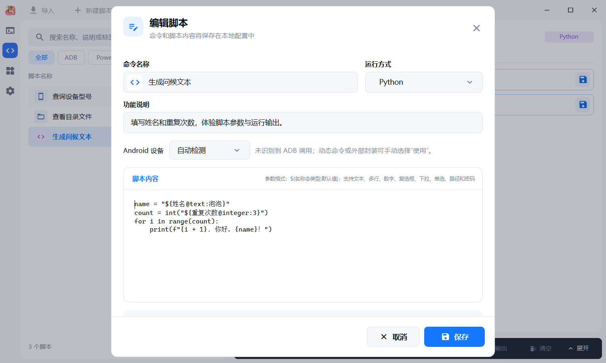

# 自定义脚本指南

本文介绍脚本参数、默认值和分享迁移。功能概览见 [README](../README.md)。



## 创建与管理

1. 进入“自定义”。
2. 点击右上角“新建脚本”。
3. 填写名称、说明，选择图标和 `PowerShell`、`Bash`、`Batch 脚本` 或 `Python`。
4. 输入脚本内容并保存。
5. 在右侧详情区填写参数，然后点击“运行脚本”。

自定义页面采用脚本列表与详情区并排布局。列表可筛选 Batch、PowerShell 和 Python，并按添加时间、名称或使用频率排序；搜索会匹配脚本名称、说明和运行方式。详情区提供分享、编辑、删除、运行/停止以及可展开的控制台输出。

选中主界面列表中的脚本后，名称右侧会依次显示编辑、删除、分享、运行四个图标按钮，悬停可查看说明；较长的名称会自动省略，为按钮留出空间。运行中的脚本禁用编辑和删除，运行按钮切换为停止。

在主界面选择“自定义排序”后，可拖动脚本左侧的手柄调整位置，松开后自动保存顺序；拖到列表上下边缘会自动滚动，按 Esc 可取消。搜索或筛选后的列表同样支持拖拽，运行中的脚本保持置顶，暂不参与拖拽调整。

在主界面双击脚本可快速运行。已选中的脚本使用当前填写的参数，切换到其他脚本时使用其默认参数；需要确认的脚本仍会弹出确认窗口。双击正在运行的脚本不会停止或重复启动该脚本。

ZIO 和 DECADE 主题的悬浮脚本卡片在底部提供整块可点击的主题运行按钮，运行时切换为停止，执行结束后可再次运行。次数区仅保留色块和数字，参数仍采用左侧标题、右侧输入的同框布局；展开控制台或滚动参数时，运行按钮保持在底部。

右侧“参数配置”区域支持文件和文件夹选择，文本输入框右侧的保存图标用于“设为默认值”。文件、文件夹参数框会并排显示保存和选择按钮。

同一个脚本不能重复启动。达到运行容量上限时，应用会提示是否停止最早启动的任务后运行新任务。

## 脚本中的 Android 设备

默认静态检测脚本中的 ADB 调用：支持直接命令、带引号的 ADB 路径、常见 Shell 调用和 Python 的 `subprocess` / `os.system` 调用。只读取直接引用的本地脚本，不执行脚本进行检测，也不追踪导入模块。动态拼接或第三方封装无法可靠识别时，在编辑器中将“Android 设备”改为“使用”；选“不使用”可关闭设备选择。

设备选择全局共享并保存，切换或删除脚本不会改变所选设备，分享脚本不会携带设备记录。自定义页面的设备选择器位于标题栏。首次只有一台可用设备时自动选择，多台时手动选择。当前设备仍在线时，新设备接入不会抢占选择；当前设备断开后有新设备接入时，自动替换为新接入的设备。也可展开下拉框刷新或手动选择，已提交的任务继续使用提交时的设备。

应用通过本次进程的 `ANDROID_SERIAL` 指定设备，不修改脚本。脚本中的 `adb -s`、`-d`、`-e`、`-t` 保持原样；界面选择仅作用于没有显式指定目标的调用。只有 `devices`、`version`、`help`、`start-server`、`kill-server`、`connect`、`disconnect` 等已识别的主机操作时，无须选择设备。已经提交或运行的任务保持提交时的设备。

## 用占位符生成参数控件

统一格式为 `${名称@类型:默认值}`，类型和默认值均可省略。新脚本推荐显式标注类型：

| 控件 | 模板示例 | 行为 |
| --- | --- | --- |
| 单行文本 | `${名称@text:示例}` | 省略类型时默认使用文本框 |
| 多行文本 | `${说明@multiline}` | 保留输入中的换行 |
| 整数 | `${重试次数@integer:3}` | 输入及运行前校验整数 |
| 数字 | `${比例@number:0.5}` | 支持整数、小数和科学计数法 |
| 复选框 | `${启用缓存@boolean:true}` | 输出 `true` / `false`；省略默认值时不勾选 |
| 下拉单选 | `${模式@choice:开启=1\|关闭=0}` | 显示标签，输出对应值；第一项为默认选项 |
| 单选按钮组 | `${环境@radio:开发=dev\|生产=prod}` | 显示标签，输出对应值；第一项为默认选项 |
| 文件 | `${输入文件@file:./input.txt}` | 输入路径或浏览选择文件 |
| 目录 | `${输出目录@dir:./output}` | 输入路径或浏览选择目录 |
| 密码 | `${访问令牌@secret}` | 隐藏输入；支持声明默认值和保存当前输入 |

显式 `@text` 的默认值始终作为文本处理，例如 `${内容@text:开启=1|关闭=0}` 不会创建下拉框。多行内容在输入框中填写，替换时保留换行；脚本需要按所用语言正确处理引号和转义。

旧脚本继续兼容 `${名称}`、`${名称:默认值}`、`${名称=默认值}`、`${标题:开启=1|关闭=0}`、`${开启=1|关闭=0}` 以及 `Var` / `pVal` 声明。下面的省略类型写法仍然有效：

使用 `${标题}` 创建空文本输入框：

```powershell
adb shell settings put global auto_time ${自动设置时间}
```

使用 `${标题:默认值}` 提供可修改的默认值：

```powershell
adb shell cmd alarm set-time ${时间戳:1786356497528}
```

使用 `${标题:选项文字=实际值|选项文字=实际值}` 创建选择框：

```powershell
adb shell settings put system show_touches ${触摸点显示:开启=1|关闭=0}
```

使用 `${标题@file}` 创建带文件选择按钮的路径输入框，也可以通过
`${标题@file:默认路径}` 指定默认路径。点击文件按钮时，如果当前输入框中已有路径，
文件管理器会从该路径所在目录打开：

```powershell
adb install "${APK安装包@file:C:\Downloads\example.apk}"
```

使用 `${标题@dir}` 创建文件夹选择参数，或用 `${标题@dir:默认路径}` 设置默认文件夹。
点击输入框右侧的文件夹图标打开系统文件夹选择器：当前路径是文件夹时从该目录打开，
是文件时从所在目录打开；也可以直接输入或拖入文件夹路径。取消选择时保留原值。

```powershell
Get-ChildItem "${日志目录@dir:C:\Logs}"
```

| 参数写法 | 选择对象 | 支持默认路径 |
| --- | --- | --- |
| `${文件@file}` | 已有文件 | `${文件@file:C:\Logs\app.log}` |
| `${目录@dir}` | 文件夹 | `${目录@dir:C:\Logs}` |

文件和文件夹路径仍按普通文本替换，路径可能包含空格时需按照脚本语言规则自行添加引号。

脚本需要多次使用同一参数，或需要分开内部变量名与界面标题时，可以在脚本开头声明 `Var`：

```powershell
Var timestampMs = ${时间戳:1786356497528}

Write-Host "即将设置 Android 设备时间"
adb shell cmd alarm set-time ${timestampMs}
```

`Var` 声明行只用于参数元数据，不会交给脚本解释器执行，关键字不区分大小写，`var logs=${日志目录@dir:C:\Logs}` 也有效。文件、文件夹参数也支持这种声明方式，例如 `Var logs = ${日志目录@dir:C:\Logs}`，脚本正文中使用 `${logs}` 引用。旧版脚本中的 `pVal` 声明仍可继续使用，但新脚本统一推荐使用 `Var`。

Python 字符串中的占位符需要自行添加引号：

```python
keyword = "${搜索关键词:Android 工具}"
count = int("${数量:3}")
print(keyword, count * 2)
```

占位符是在执行前进行文本替换。处理不可信内容、路径、引号和特殊字符时，应使用对应脚本语言的安全转义方式。

## 将当前输入设为默认值

自定义脚本详情页和预设命令参数页的文本参数框提供保存图标，鼠标悬停显示“设为默认值”。适用于普通文本、密码、数字、文件路径、文件夹路径和多行文本参数；下拉选项、单选按钮组和复选框不使用该按钮。数字默认值保存前也会校验类型。

1. 在参数框中输入内容，或通过文件、文件夹选择器填入路径。
2. 点击该输入框右侧的保存图标；文件、文件夹参数的保存按钮位于选择按钮左侧，多行文本的按钮位于右上角。
3. 当前内容立即保存为这个参数的默认值，重新选择脚本或重启应用后仍会保留。

空输入也可以保存，用于清空原默认值。保存一个参数不会清空其他输入框中正在编辑的内容。脚本运行期间保存按钮不可用。

默认值保存在本地工具配置中；预设工具使用本地覆盖配置，不修改内置文件。对于可编辑脚本，能通过占位符语法表示的值还会同步写回脚本模板；多行或包含花括号等不能直接写入占位符的内容保存在参数配置中。

## 分享、导入与导出

分享单个脚本时，在右侧详情区点击“分享”，应用会将带格式标识和版本号的脚本 JSON 写入剪贴板。分享内容不携带参数默认值：参数配置中的默认值和脚本占位符中的默认内容都会移除，包含 `Var` / `pVal` 声明及文件、文件夹参数；参数名称、类型和下拉选项保留。本地脚本及其默认值不变，接收方需自行填写参数。设置中的批量导出仍用于完整备份，不受此规则影响。

接收方点击自定义页面的“导入”按钮即可读取：

- 脚本 ID 不存在时追加到当前列表；
- 相同自定义脚本 ID 已存在时询问是否替换；
- 与内置功能 ID 冲突、格式无效或使用内部执行器的内容会被拒绝。

在“设置 → 脚本目录”中可以批量迁移：

1. “导出脚本”在系统文档目录创建包含 `tools` 和 `scripts` 的时间戳目录。
2. “导入脚本”选择之前导出的目录。
3. 导入前自动备份现有脚本，再将导入内容合并；同路径文件使用导入版本，其他本地脚本保留。

批量迁移只处理脚本相关文件，不覆盖外观、更新、设备选择、Jira 飞书方案等应用设置。
